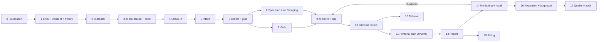

# SIMS AI Preventive Health Intelligence Platform — Functional Blueprint

| | |
|---|---|
| **Status** | Draft v1 — 23 Oct 2026 |
| **Audience** | Product, clinical leads, SIMS stakeholders, delivery team |
| **Companion** | [`technical-blueprint.md`](./technical-blueprint.md) (architecture, APIs, data model, gap-closure design) |
| **Sources** | *Preventive Health Screening – FHIR Workflow* (FHIR R4 reference, 16 phases); *SIMS AI Preventive Health Intelligence Platform* (proposal); current `drgodly` source; `fhir-gql` / `fhir-server` / `fhir-staging` at their current commits |

> **How to read this document.** It describes *what the platform does for each person at each stage* and, for every stage,
> *which FHIR resources are read, created or updated*. Every resource is tagged with what exists **today** in our stack, so
> this is both a target design and an honest gap map. The technical blueprint explains *how* each stage is built.

---

## 1. Purpose and scope

SIMS runs episodic preventive health packages (Basic Health Screening, Diabetic Health Screening, Young Diabetic, Senior
Citizen, SHE). The proposal turns that into a continuous loop:

```
Assess → Screen → Understand → Predict → Personalize → Intervene → Monitor → Re-screen → Measure outcomes
```

This blueprint covers the full workflow, from programme set-up to population analytics, in three product layers:

| Layer | Name | What it does |
|---|---|---|
| **L1** | AI Screening Intelligence | Turns package results into an explainable multi-domain risk profile and a year-over-year **Health Trajectory** |
| **L2** | AI Preventive Care | Turns risk into a personal plan with 30/60/90-day interventions, monitoring, coaching and re-assessment |
| **L3** | AI Population Intelligence | Turns thousands of records into a command-centre view: who needs attention today, adherence, outcomes, corporate aggregates |

**Design principles**

1. **The clinician decides.** AI output is always a *suggestion* until a clinician accepts it (the same staging → accept → EMR model already used in the post-consultation review).
2. **FHIR is the system of record** for clinical and administrative facts. Proprietary working data (chat transcripts, drafts, AI session state) stays outside FHIR and is linked by id.
3. **Package-aware, not package-new.** The AI engine interprets SIMS's *existing* packages and recommends pathways; it does not invent a generic package.
4. **Explainable by construction.** Every risk score references the Observations it was derived from, the method, and the model version.
5. **Tenant-isolated.** Every record belongs to one organisation (`org_id` taken from the caller's JWT, never from the client body).
6. **Employer sees aggregates only.** No individual medical data is exposed to a sponsoring company.

### Status legend (used throughout)

| Tag | Meaning |
|---|---|
| ✅ **Live** | Resource has fhir-server model + fhir-gql REST endpoints **and** is wired in the drgodly app (server module or A2UI workflow) |
| 🟡 **Gateway-ready** | Exists in fhir-server **and** fhir-gql, but no drgodly screen/workflow drives it yet |
| 🟠 **Server-only** | Exists in fhir-server, but **no fhir-gql router** — cannot be called through the gateway yet |
| 🔴 **Not built** | Not present in fhir-server — new work |

Resource and phase names follow FHIR R4 (4.0.1). Codes (LOINC, SNOMED CT, ICD-10) shown in examples must be validated against
the terminology server and the ABDM/NRCeS India profiles before production use. Clinical thresholds are programme-protocol
decisions, not defined here.

---

## 2. Actors

| Actor | Role | Main FHIR resources they touch |
|---|---|---|
| Programme manager | Defines packages, protocols, eligibility, quotas; reads coverage reports | `PlanDefinition`, `ActivityDefinition`, `Questionnaire`, `HealthcareService`, `Organization` |
| Registrar / call-centre | Enrols members, books slots, captures consent | `Patient`, `Coverage`, `Appointment`, `EpisodeOfCare` |
| Patient / member | Takes AI pre-screen, books, receives report, follows plan, chats with coach | `Patient`, `QuestionnaireResponse`, `Appointment`, `Vitals` |
| Nurse / technician | Check-in, vitals, anthropometry, specimen collection | `Encounter`, `Observation`, `Specimen`, `Procedure` |
| Physician | Reviews AI profile, confirms conditions, counsels, prescribes, refers | `Condition`, `RiskAssessment`, `CarePlan`, `ServiceRequest`, `MedicationRequest` |
| Laboratory / radiology | Fulfils orders, reports results | `Task`, `DiagnosticReport`, `Observation`, `DocumentReference` |
| Care coordinator | Chases referrals, recalls, high-risk-no-follow-up lists | `Task`, `Appointment`, `Flag` |
| Payer / employer (TPA) | Verifies cover; sees **aggregate** dashboards only | `Coverage`, `Organization` |
| Billing clerk | Charges, claims, invoices | `Claim`, `Invoice` |
| Hospital leadership | Population command centre | read-only analytics |
| **AI agents** | Pre-screen intake, extraction, risk engine, copilot, coach | write *suggestions* (staging / draft) — never silent clinical writes |

---

## 3. Workflow at a glance

Phase 0 happens once per programme/protocol version; phases 1–15 repeat per person. Phases marked ★ are the SIMS-specific
intelligence extensions beyond the standard screening workflow.

| # | Phase | Trigger → outcome | Primary resources | Today |
|---|---|---|---|---|
| 0 | Administrative foundation | Programme launch → providers, services, slots, protocols, forms exist | Organization, Location, Practitioner, PractitionerRole, HealthcareService, Schedule, Slot, PlanDefinition, ActivityDefinition, Questionnaire | ✅/🟡 |
| 1 | Enrollment, consent & history import ★ | Person joins → record, cover, consent, historical data on file | Patient, Coverage, EpisodeOfCare, DocumentReference, (Consent) | ✅/🟠/🔴 |
| 2 | Outreach & eligibility | Cohort chosen → invited, cover verified | (Group), (CommunicationRequest), (CoverageEligibility*) | 🔴 |
| 3 | AI pre-screen & scheduling | Patient answers → intake report; slot booked | QuestionnaireResponse, Slot, Appointment | ✅ |
| 4 | Check-in & encounter | Arrival → open Encounter | Appointment, Encounter, Flag, EpisodeOfCare | ✅/🟡 |
| 5 | Intake & history | Questionnaire → structured risk factors | QuestionnaireResponse, Observation, Condition, AllergyIntolerance | ✅/🟠 |
| 6 | Orders & care plan | Package protocol applied → orders & tasks | PlanDefinition, CarePlan, CareTeam, ServiceRequest, Task | 🟡 |
| 7 | Vitals & measurements | Measured → Observations | Observation, Procedure | ✅ |
| 8 | Specimen, lab & imaging | Fulfilled → results reported | Specimen, Task, Observation, DiagnosticReport, DocumentReference | ✅/🟠 |
| 9 | AI health profile & risk ★ | Results in → risk domains + trajectory | RiskAssessment, Observation, Condition | 🟡 |
| 10 | Clinician review & findings ★ | Copilot summary → confirmed findings | Condition, RiskAssessment, Flag, (ClinicalImpression) | ✅/🟡/🔴 |
| 11 | Personal plan, counselling & prevention ★ | Findings explained → 30/60/90 plan | CarePlan, Task, MedicationRequest, Procedure, (Goal), Immunization | 🟡/🔴 |
| 12 | Referral | Abnormal → specialist referral tracked | ServiceRequest, Task | 🟡 |
| 13 | Report & documents | Visit closed → report released | Encounter, DocumentReference, DiagnosticReport, (Composition) | ✅/🔴 |
| 14 | Remote monitoring, coaching & recall ★ | Between visits → signals, nudges, rebook | Vitals, Observation, Task, Appointment, (Communication) | ✅/🟡/🔴 |
| 15 | Billing & claims | Services rendered → claim, payment | Coverage, Claim, Invoice | 🟠/🔴 |
| 16 | Population intelligence & corporate ★ | Continuous → command centre, employer aggregates | all (read), (Group), (Measure) | 🔴 |
| 17 | Quality, audit, consent & provenance | Continuous → trail, governance | Provenance, AuditEvent, (Consent) | 🟠/🔴 |

> The reference workflow numbers billing as 14 and quality as 15. Here, the SIMS intelligence extensions are interleaved, so
> the numbers shift by one after phase 13 (see the crosswalk in Appendix B).



---

## 4. Phase-by-phase functional specification

Notation in resource tables: **C** = create, **R** = read/search, **U** = update/patch, **D** = delete.
Resource names in parentheses are not built yet.

### Phase 0 — Administrative foundation

**Who:** programme manager, IT, clinical lead. **When:** once, and on each protocol version.
**Outcome:** everything that must exist before the first person can be booked.

**Functional behaviour**
- Create the organisation tree: SIMS (provider), lab, radiology, payers, corporate sponsors.
- Define locations (clinic, phlebotomy station, imaging suite), practitioners and their roles/specialties.
- Define the bookable service per package (e.g. "Basic Health Screening", "Diabetic Health Screening") with eligibility and prep rules (fasting).
- Define availability (Schedule) and generate bookable Slots in bulk.
- Encode each package as a **protocol** (PlanDefinition) whose actions are orderable templates (ActivityDefinition) and forms (Questionnaire). Package-awareness lives here.
- Define the AI-risk **domains** and the observations each domain depends on (see §6).

| Resource | Ops | Purpose in this phase | Today |
|---|---|---|---|
| Organization | C R U | Hospital, lab, radiology, payer, employer sponsor | ✅ |
| Location | C R U | Clinic, rooms, stations (hierarchy via `partOf`) | ✅ |
| Practitioner | C R U | The person (clinician, nurse, technician) | ✅ |
| PractitionerRole | C R U | Practitioner at an organisation/location/specialty | ✅ |
| HealthcareService | C R U | The bookable package service | ✅ |
| Schedule | C R U | Availability container for a practitioner/location/service | ✅ |
| Slot | C (bulk generate) R U | Bookable windows; `free → busy` | ✅ |
| PlanDefinition | C R U | Package protocol: what tests, for whom, when | 🟡 |
| ActivityDefinition | C R U | Orderable template per test/counselling | 🟡 |
| Questionnaire | C R U | Pre-screen and lifestyle forms | 🟡 |
| InsurancePlan | C R | Payer product covering a package | 🟠 |
| Device / DeviceDefinition | C R | BP monitor, scale, analyser | 🔴 (only `DeviceRequest` exists, 🟠) |
| ObservationDefinition / SpecimenDefinition | C R | Test metadata, reference ranges | 🔴 |
| CapabilityStatement / ValueSet / CodeSet | R | Conformance and code lists | 🟡 (served by the custom `/terminology` module, not FHIR-native) |

**Business rules**
- A PlanDefinition version is immutable once in use; changes create a new version (`url` + `version`).
- Slots are generated within the Schedule's planning horizon (the generator clamps to it).

### Phase 1 — Enrollment, consent & history import ★

**Who:** registrar, patient. **When:** first contact or sponsor file upload. **Outcome:** identified patient, active cover, consent, programme episode, and — for returning SIMS patients — historical results ingested.

**Functional behaviour**
- Register or match the Patient (search before create; national ID such as ABHA stored as an identifier, never as the resource id).
- Capture insurance/employer cover; link the sponsor organisation.
- Capture **consent** with explicit purposes: treatment, payment, AI-assisted analysis, wearable data, research, and — for corporate cohorts — aggregate reporting to the employer.
- Open a long-running **EpisodeOfCare** ("SIMS Preventive Programme 2026") that spans visits.
- ★ **History import (MedIngest):** upload historical reports (2024, 2025…). Each file is registered in staging, an AI agent extracts Observations, a clinician reviews, and accepted data is promoted to the main record so trajectories have a baseline.

| Resource | Ops | Purpose | Today |
|---|---|---|---|
| Patient | C R U | Demographics, identifiers, contacts; `GET /patients/me` for self-service | ✅ |
| RelatedPerson | C R U | Caregiver/nominee who may act for the patient | 🟠 (A2UI workflow `create_related_person` exists but there is no gateway router) |
| Coverage | C R U | Insurance / employer cover | 🟠 (workflow `create_coverage` exists; no gateway router) |
| EpisodeOfCare | C R U | Programme enrolment spanning visits | 🟡 |
| (Consent) | C R U | Purpose-scoped permissions | 🔴 |
| DocumentReference | C R | Index entry for imported historical reports | ✅ |
| (Person / Linkage) | C R | MPI link across duplicate records | 🔴 |
| *Staging record + staging observations* | C R U | Pre-review holding pen for extracted history (**not FHIR**, flattened R4 tables in `fhir-staging`) | ✅ |
| Observation / DiagnosticReport | C | Promoted history after clinician acceptance | ✅ |

**Business rules**
- No FHIR write for AI-extracted history until a clinician records `accepted` on the staging record (review status is separate from extraction status).
- Without an active `Consent` for AI analysis, the risk engine must not run for that patient (enforcement requires the Consent resource — see gap G1).

### Phase 2 — Outreach & eligibility

**Who:** care coordinator, payer. **Outcome:** invitations sent, cover verified.

**Functional behaviour**
- Select a cohort (e.g. "women 40+ not screened in 24 months, Acme Corp, Oct 2026 wave"; or "diabetic-package patients due for annual re-screen").
- Send invitations/reminders in the patient's preferred language and channel; record the intent and the actual send.
- Ask the payer whether the package is covered before the visit.

| Resource | Ops | Purpose | Today |
|---|---|---|---|
| (Group) | C R | Eligible cohort | 🔴 |
| (CommunicationRequest) / (Communication) | C R U | Invitation intent and actual message | 🔴 |
| (CoverageEligibilityRequest / Response) | C R | Pre-visit benefit check | 🔴 |
| Coverage, Organization | R | Cover and payer | 🟠 / ✅ |

**Interim approach (until built):** cohort selection and notifications run as application jobs, with a `Task` (✅ gateway) per outreach attempt so state is not lost. See technical blueprint §9.

### Phase 3 — AI pre-screen & scheduling

**Who:** patient (self-service) or registrar. **Outcome:** AI intake report on file; Appointment booked and Slot reserved.

**Functional behaviour**
- Patient completes the **AI intake** (text or voice). The AI produces a structured clinical assessment (risk level, differential, etc.). This is the "pre-screening questionnaire" in the SIMS mapping.
- Patient (or registrar) searches practitioners/services, picks a free slot, and books. Booking is atomic: availability check → Appointment created with participants → Slot set busy; if marking the slot busy fails the Appointment is rolled back. A taken slot returns a conflict.
- Prep instructions (fasting) travel on the Appointment; reminders are sent before the visit.
- Reschedule and cancel free the old slot; no-shows feed recall (phase 14).
- The intake is linked to the Appointment after booking so the doctor sees it.

| Resource | Ops | Purpose | Today |
|---|---|---|---|
| Slot | R U | Search free; `free → busy` | ✅ |
| Appointment | C R U D | Booked visit (`/appointments/book`, `/me`, reschedule) | ✅ |
| Practitioner / PractitionerRole / HealthcareService | R | Provider search | ✅ |
| Patient | R | Booking requires an existing profile | ✅ |
| QuestionnaireResponse | C R | Structured pre-screen answers (target; today the intake lives in the app database) | 🟡 |
| (AppointmentResponse) | C | Participant accept/decline | 🔴 |

> **Today vs target.** The AI intake transcript and report are stored in the application's own Postgres (`Intake`,
> linked by `fhir_appointment_id`) because they are proprietary AI session data. The *structured answers* that matter
> clinically should additionally be written as a `QuestionnaireResponse` (see phase 5).

### Phase 4 — Check-in & encounter

**Who:** front desk, nurse. **Outcome:** Encounter open; every later resource points to it.

**Functional behaviour**
- On arrival, mark the Appointment `arrived`; verify identity (two identifiers) and re-confirm cover.
- Create the **Encounter** from the Appointment and link it to the EpisodeOfCare. It is the spine of the visit: observations, orders, reports and charges all reference it.
- Raise alerts that every staff member should see (language, mobility, critical result pending).

| Resource | Ops | Purpose | Today |
|---|---|---|---|
| Appointment | R U | `booked → arrived → fulfilled` | ✅ |
| Encounter | C R U | Visit anchor (`planned → in-progress → finished`) | ✅ |
| EpisodeOfCare | R U | Link visit to programme year | 🟡 |
| Flag | C R U | Staff-visible alerts | 🟡 |

### Phase 5 — Intake & history

**Who:** patient, nurse. **Outcome:** raw answers kept faithfully, clinically useful facts extracted into discrete, searchable resources.

**Functional behaviour**
- Lifestyle and history questionnaire (smoking, alcohol, activity, diet, family CVD, symptoms, PHQ-2, sleep) is stored as a **QuestionnaireResponse**.
- Facts are extracted into **Observations** (social history, scores), **Conditions** (pre-existing), **AllergyIntolerance**, and (target) FamilyMemberHistory and MedicationStatement. Each extracted Observation points back to its response (`derivedFrom`).
- "No known allergy" and "no current medication" are recorded explicitly.

| Resource | Ops | Purpose | Today |
|---|---|---|---|
| QuestionnaireResponse | C R U | Faithful record of answers | 🟡 (workflow `record_questionnaire_response` exists) |
| Observation | C | Social-history / lifestyle / score values | ✅ |
| Condition | C | Known problems | ✅ |
| AllergyIntolerance | C | Allergies (incl. NKA) | 🟠 (workflow exists; no gateway router) |
| (FamilyMemberHistory) | C | Family risk factors | 🔴 |
| (MedicationStatement) | C | Current medicines | 🔴 (interim: `MedicationRequest` with an appropriate intent/status, or note) |

### Phase 6 — Orders & care plan

**Who:** physician / system. **Outcome:** package orders, a care plan, and fulfilment tasks ready.

**Functional behaviour**
- The package PlanDefinition is applied to the patient: unconditional actions plus conditional ones (e.g. mammography for women 40+).
- Each action becomes a **ServiceRequest** (lab/imaging/consult) grouped by a requisition id; each gets a **Task** the lab/radiology can accept, perform and complete.
- A **CarePlan** (screening plan) and **CareTeam** (who is responsible) are created.
- **AI package-awareness:** before ordering, the AI may suggest add-ons from history (e.g. add urine microalbumin for rising HbA1c); the clinician accepts or declines.

> There is no server-side `PlanDefinition/$apply` operation in our stack. Application code evaluates the protocol and
> creates the resources (technical blueprint §6.6).

| Resource | Ops | Purpose | Today |
|---|---|---|---|
| PlanDefinition / ActivityDefinition | R | The protocol and templates | 🟡 |
| ServiceRequest | C R U | Lab, imaging, referral orders | ✅ |
| Task | C R U | Fulfilment tracking (`requested → accepted → in-progress → completed`) | 🟡 |
| CarePlan | C R U | Screening/follow-up plan | 🟡 (workflow `create_care_plan_with_task` exists) |
| CareTeam | C R U | Responsible people | 🟡 |
| MedicationRequest | C | If a baseline prescription is part of the protocol | ✅ |
| (DeviceRequest) | C | Device-based tests (e.g. ECG) | 🟠 |

### Phase 7 — Vitals & measurements

**Who:** nurse, devices. **Outcome:** structured vital-sign and anthropometry Observations.

**Functional behaviour**
- Record BP (systolic/diastolic panel), pulse, height, weight, BMI (derived), waist circumference, SpO₂, with interpretation (H/N/L) so abnormal values are searchable.
- Link each Observation to the Encounter, performer, body site, and (target) the calibrated Device.
- ECG performed is recorded as a Procedure plus a DiagnosticReport/DocumentReference for the trace.

| Resource | Ops | Purpose | Today |
|---|---|---|---|
| Observation | C R U | `vital-signs` and `exam` categories | ✅ |
| Procedure | C R U | Acts performed (ECG, venepuncture) | 🟡 (workflow `record_procedure` exists) |
| Vitals *(custom, non-FHIR)* | C R U D | Wearable/manual activity & vitals stream | ✅ — see phase 14 |
| (Device) | R | Instrument traceability | 🔴 |

### Phase 8 — Specimen, lab & imaging

**Who:** phlebotomist, lab, radiology. **Outcome:** results reported; critical values escalated.

**Functional behaviour**
- Collect specimens (fasting status recorded); the lab accepts the Task, runs tests, posts one Observation per analyte, grouped under a DiagnosticReport carrying the conclusion.
- Reference ranges and interpretation are copied onto each Observation so downstream apps (including the risk engine) need no lab-specific logic.
- Results move `registered → preliminary → final → amended`; a final result is never silently overwritten.
- Critical values raise an alert and a phone-call Task.
- Imaging (X-ray, USG, mammography, Echo) is reported as DiagnosticReport; the report PDF/images are indexed as DocumentReference.

| Resource | Ops | Purpose | Today |
|---|---|---|---|
| Specimen | C R U | Blood/urine sample, collection time, fasting | 🟠 (workflow `record_specimen` exists; no gateway router) |
| Task | U | Lab fulfilment status | 🟡 |
| Observation | C R U | One per analyte (HbA1c, lipids, creatinine, ALT…) | ✅ |
| DiagnosticReport | C R U | Lab panel / radiology report | ✅ |
| DocumentReference | C R | Report PDF, ECG trace, images | ✅ |
| (ImagingStudy) | C R | DICOM study link | 🔴 |
| (DetectedIssue) | C | Critical/conflicting result | 🔴 (interim: `Flag` + `Task`) |

### Phase 9 — AI health profile & risk ★

**Who:** risk engine (automatic), reviewed in phase 10. **Outcome:** multi-domain risk profile with contributors, plus a longitudinal trajectory.

**Functional behaviour**
- When results for the encounter are `final`, the engine computes a **domain profile**: Metabolic, Cardiovascular, Diabetes, Kidney, Liver, Nutrition, Fitness, Sleep (plus age-specific variants: adolescent, women's health, senior).
- Each domain yields a **RiskAssessment**: qualitative risk (low / moderate / high), optional probability, the *basis* (the Observations used), the *method* (model name + version), and a plain-language rationale.
- The engine compares with prior years' assessments to set a **trend** (↑ → ↓) and builds the **Health Trajectory** (year × domain heat-map) — the flagship screen.
- It identifies **top-3 priorities** and recommends a **pathway** (e.g. "SIMS Diabetes Prevention Pathway") by selecting a PlanDefinition.
- All of the above are *proposed*; nothing is shown to the patient until a clinician accepts (phase 10).

| Resource | Ops | Purpose | Today |
|---|---|---|---|
| RiskAssessment | C R U | One per domain per assessment date; `prediction.qualitativeRisk`, `probability`, `basis`, `method`, `performer` (Device/AI), `note` | 🟡 |
| Observation | R | Inputs (labs, vitals, lifestyle scores); also output: derived composite scores | ✅ |
| Condition | R | Existing diagnoses influence risk | ✅ |
| EpisodeOfCare | R | Groups assessments per programme year for trajectory | 🟡 |
| PlanDefinition | R | Pathway recommendation target | 🟡 |
| (Provenance) | C | Record "AI model vX produced this from Y" | 🟠 |

**Business rules**
- A RiskAssessment is `preliminary` until accepted, then `final`; a newer assessment never overwrites an older one — history is the product (trajectory).
- Every RiskAssessment must carry `basis` references and a `method` identifying model + version, so any score can be explained and reproduced.
- Missing inputs lower confidence and are listed; the engine never imputes silently.

### Phase 10 — Clinician review & findings ★

**Who:** physician. **Outcome:** confirmed findings; AI suggestions accepted, edited or rejected.

**Functional behaviour**
- **Preventive Health Copilot:** the doctor opens the patient and sees a one-screen summary — overall risk, *improving / worsening / new concern*, previous screenings (2024 → 2025 → 2026), and **Next Best Actions** (lifestyle intervention, nutrition consult, repeat HbA1c in N months, monitor weight, consider follow-up).
- The doctor edits, accepts or removes each suggestion; accepted items are written to the EMR with the same *diff* semantics as the current post-consultation review (create new, update edited, delete removed).
- New diagnoses (e.g. prediabetes) become **Conditions**; the physician's overall assessment is recorded; critical items raise Flags.
- The doctor's autosaved draft is kept apart from the confirmed record, so a half-finished edit never overwrites what is already in the EMR.

| Resource | Ops | Purpose | Today |
|---|---|---|---|
| Condition | C R U D | Newly identified / confirmed problems | ✅ |
| RiskAssessment | U | `preliminary → final`; clinician note | 🟡 |
| Flag | C R U | Critical-result outstanding, high-risk-no-follow-up | 🟡 |
| ServiceRequest / MedicationRequest | C R U D | Accepted next-best-action orders | ✅ |
| (ClinicalImpression) | C | Overall assessment of the visit | 🔴 (interim: `Encounter` notes / report text) |
| (Provenance) | C | Who accepted what, when | 🟠 |

### Phase 11 — Personal plan, counselling & prevention ★

**Who:** physician, nurse, nutritionist, patient. **Outcome:** an owned, time-boxed plan.

**Functional behaviour**
- Create the **personal plan**: priorities (top 3), goals with measurable targets (BP, weight, steps/week, HbA1c), and **30/60/90-day** activities (nutrition, fitness, sleep, repeat tests).
- Counselling sessions are recorded as Procedures; vaccines due are noted; prescriptions issued.
- Activities become **Tasks** (owner: patient, nurse, coordinator) with due dates so adherence is measurable.

| Resource | Ops | Purpose | Today |
|---|---|---|---|
| CarePlan | C R U | Plan with activities and `period`; one per pathway | 🟡 |
| CareTeam | C R U | Plan owners | 🟡 |
| Task | C R U | Each 30/60/90 activity, with `restriction.period` | 🟡 |
| MedicationRequest | C R U | Prescriptions | ✅ |
| Procedure | C | Counselling session performed | 🟡 |
| (Goal) | C R U | Measurable targets | 🔴 (interim: targets as `CarePlan.activity` details + Observation targets) |
| Immunization | C R | Vaccine given | 🟠 |
| (ImmunizationRecommendation) | C R | Vaccines due | 🔴 |

### Phase 12 — Referral

**Who:** physician, coordinator. **Outcome:** specialist referral tracked to completion.

**Functional behaviour**
- Abnormal finding → referral ServiceRequest (cardiology, diabetology, nephrology, ophthalmology, gynaecology…), with reason and urgency.
- A Task tracks scheduling, attendance and report return; the coordinator sees overdue referrals.
- The referral outcome (DocumentReference/DiagnosticReport from the specialist) feeds the next risk re-assessment.

| Resource | Ops | Purpose | Today |
|---|---|---|---|
| ServiceRequest | C R U | `category = referral` | ✅ |
| Task | C R U | Referral fulfilment | 🟡 |
| Appointment | C R | Specialist visit | ✅ |
| DocumentReference | R | Returned specialist report | ✅ |

### Phase 13 — Report & documents

**Who:** physician, system. **Outcome:** visit closed; patient-readable report released.

**Functional behaviour**
- Close the Encounter; mark the Appointment fulfilled.
- Generate the **report**: the longitudinal profile (domain table + trend + top-3 priorities), results with ranges, the plan, and next steps — in the patient's preferred language, with a plain-language summary alongside the clinical one.
- The report is stored as a document and indexed; the patient can open it from the app, and ask the coach about it.

| Resource | Ops | Purpose | Today |
|---|---|---|---|
| Encounter | U | `in-progress → finished` | ✅ |
| DocumentReference | C R | Index of the final PDF | ✅ |
| DiagnosticReport | R | Results grouped for the report | ✅ |
| (Composition) / (Binary) / (Bundle) | C | FHIR document form for exchange (ABDM) | 🔴 |

### Phase 14 — Remote monitoring, coaching & recall ★

**Who:** patient, AI coach, care coordinator, clinician. **Outcome:** continuous signals between checkups, timely nudges, re-screening.

**Functional behaviour**
- **Wearables:** steps, active minutes, heart rate, resting HR, HRV, sleep, weight, BP, and more flow in through the **Vitals** API (mobile/wearable sources). The doctor dashboard already surfaces a subset (four insight fields) pending confirmation of further wearable data.
- **Coach:** a patient chat grounded in *their* SIMS data ("What should I focus on?", "Why is my diabetes risk increasing?", "How am I vs. last year?"). It reads the plan and signals; it does not diagnose and never changes clinical records.
- **Rules & nudges:** adherence slips, deteriorating signals or due tests create **Tasks** for the coordinator/clinician and notifications to the patient.
- **Reassessment:** at 30/60/90 days, or on a signal threshold, the engine re-runs (phase 9) and the clinician reviews (phase 10). The next annual re-screen is invited via phase 2.
- **Recall:** no-shows, overdue referrals and "high-risk, no follow-up" cases are surfaced as worklists.

| Resource | Ops | Purpose | Today |
|---|---|---|---|
| Vitals *(custom)* | C R U D | Wearable/manual stream (`/vitals`) | ✅ |
| Observation | C | Clinically significant readings promoted from the stream (e.g. home BP) | ✅ |
| Task | C R U | Nudges, follow-up, recall worklist | 🟡 |
| Appointment | C R | Rebook / re-screen | ✅ |
| CarePlan | R U | Activity progress | 🟡 |
| Flag | C | High-risk without follow-up | 🟡 |
| (Communication) / (CommunicationRequest) | C R | Reminders and coach messages as records | 🔴 |
| (Subscription) | C | Push events to apps | 🔴 (interim: polling) |

### Phase 15 — Billing & claims

**Who:** billing clerk, payer. **Outcome:** package charged, claim adjudicated, patient/sponsor billed.

**Functional behaviour**
- Package and add-on charges are recorded against the encounter; a claim is raised to the payer or an invoice to the sponsor/patient.
- For corporate cohorts, billing is to the employer organisation, but **no clinical detail** is sent.
- For the membership model (365-day programme), recurring plan fees attach to the EpisodeOfCare.

| Resource | Ops | Purpose | Today |
|---|---|---|---|
| Coverage | R | Who pays | 🟠 |
| Claim / ClaimResponse | C R | Request and adjudication | 🟠 |
| Invoice | C R | Patient/sponsor bill | 🟠 |
| (Account / ChargeItem / ChargeItemDefinition / ExplanationOfBenefit / PaymentNotice) | C R | Charge capture and reconciliation | 🔴 |

### Phase 16 — Population intelligence & corporate ★

**Who:** hospital leadership, programme manager, employer (aggregate only). **Outcome:** *"Which patients need attention today?"* answered at scale.

**Functional behaviour — Preventive Health Command Center**
- Enrolled patients; counts by risk domain (high metabolic, high CV, prediabetes, hypertension, obesity).
- **High-risk patients without follow-up** (action list for coordinators).
- Intervention adherence; % improving vs deteriorating.
- Cohort insights: metabolic risk by age band, low-activity cohorts, poor-adherence cohorts → inputs to new packages and campaigns.
- **Corporate view:** for an employer with N employees: low / moderate / high stratification and programme participation — aggregates with small-cell suppression, no individual data.

| Resource | Ops | Purpose | Today |
|---|---|---|---|
| RiskAssessment, Condition, Observation, CarePlan, Task, Appointment, Encounter | R (aggregate) | Source of every metric | ✅/🟡 |
| (Group) | C R | Corporate cohort | 🔴 |
| (Measure / MeasureReport) | C R | Coverage and outcome metrics | 🔴 (interim: analytics read model, technical blueprint §10) |

**Business rules**
- Employer dashboards show counts only, with a minimum cohort size (suppression below a threshold set by SIMS).
- Dashboards respect `org_id` tenancy; SIMS-wide views require an explicit organisation-admin permission.

### Phase 17 — Quality, audit, consent & provenance

**Who:** quality team, security/compliance. **Outcome:** a defensible trail.

**Functional behaviour**
- Every AI-generated artefact records its model version and inputs; every clinician acceptance records who and when.
- Access/export to patient data is audited (DPDP/HIPAA-style).
- Consent can be reviewed and withdrawn; withdrawal stops AI analysis, wearable ingestion and aggregate inclusion for that patient from that date.

| Resource | Ops | Purpose | Today |
|---|---|---|---|
| Provenance | C R | Authorship / AI lineage / acceptance | 🟠 (A2UI workflow `record_provenance` exists; no gateway router) |
| AuditEvent | C R | Access/export trail | 🟠 |
| (Consent) | C R U | Permissions and withdrawal | 🔴 |

---

## 5. The centrepiece: SIMS Health Trajectory

One screen, driven by phase 9–10 data: a year × domain grid (Diabetes, CVD, BP, Weight, Fitness, Sleep) with traffic-light status,
an AI-identified trend sentence ("Your metabolic risk has increased over the past 18 months, driven by HbA1c ↑, BMI ↑,
triglycerides ↑"), the **top-3 actions**, and a hand-off to the care team.

| UI element | Data source (FHIR) |
|---|---|
| Domain × year grid | `RiskAssessment` (`subject`, `date`, `prediction.qualitativeRisk`) grouped by domain code and year |
| Trend arrow | Comparison of the last two accepted `RiskAssessment`s per domain |
| Contributors (↑/↓ chips) | `RiskAssessment.basis` → `Observation` values over time |
| Top-3 actions | Open `CarePlan.activity` / `Task` ordered by priority |
| Fitness / sleep rows | `Vitals` stream aggregates (custom) and lifestyle `Observation`s |
| "Care team" button | `CareTeam` → contact / `Task` |

---

## 6. Risk domains and their inputs

The engine is **package-aware**: which inputs exist depends on the package taken. Missing inputs lower confidence and trigger a
"recommended test" suggestion rather than a score.

| Domain | Typical inputs (FHIR source) | Pathway it can recommend |
|---|---|---|
| Metabolic / Diabetes | HbA1c, fasting/PP glucose, BMI, waist, triglycerides (`Observation`); family history | Diabetes Prevention Pathway |
| Cardiovascular | BP, lipid panel, smoking, ECG/Echo `DiagnosticReport`, family CVD | Cardiometabolic Pathway |
| Renal | Creatinine/eGFR, urine microalbumin | Renal watch |
| Liver | ALT/AST, USG abdomen report, BMI, alcohol score | Metabolic-liver pathway |
| Lifestyle | Activity minutes, diet servings, sleep, smoking, alcohol, stress (`QuestionnaireResponse` → `Observation`; `Vitals`) | Nutrition / fitness / sleep |
| Age-specific | Women's health (SHE), adolescent, senior screening | Package-specific |

---

## 7. Package-aware recommendations

| Package taken (HealthcareService / PlanDefinition) | What the AI interprets | Output |
|---|---|---|
| Basic Health Screening | glucose, HbA1c, lipids, renal, liver, thyroid, ECG, BMI | Domain profile; recommends *SIMS Diabetes Prevention Pathway* when metabolic risk is elevated |
| Diabetic Health Screening | HbA1c, renal/liver, lipids, ECG/Echo, microalbumin, vascular/neuropathy/ophthalmology | Complication-risk profile |
| Young Diabetic Package | hs-CRP, Lp(a), carotid/femoral IMT, calcium score | *Young-adult cardiometabolic risk profile* |
| Senior Citizen / SHE | age-specific panels | Age-specific profile |

Each package maps to one PlanDefinition (phase 0). A recommended pathway is another PlanDefinition; accepting it produces a CarePlan (phase 11).

---

## 8. AI behaviours and clinician guardrails

| AI component | Writes | Stored where while unreviewed | Becomes record when |
|---|---|---|---|
| Pre-screen intake agent (text/voice) | Intake report | App database (`Intake`) | Linked to appointment; structured answers → `QuestionnaireResponse` |
| Document extraction (MedIngest) | Extracted Observations | `fhir-staging` (`pending → extracted`) | Clinician review `accepted`, then promoted |
| Consultation agents (SOAP, extraction) | SOAP, ServiceRequest/MedicationRequest/Observation/Condition drafts | App database (`Consultation` draft columns) | Doctor "Confirm & Save" → FHIR writes; `published_at/by` stamped server-side |
| Risk engine | `RiskAssessment` (preliminary), proposed Tasks | FHIR with `status=preliminary` (or staging) | Clinician sets `final` |
| Copilot summary | None (read-only view) | — | — |
| Patient coach | None to clinical records; may create *requests* (e.g. "ask my doctor") as Tasks | — | Staff handle the Task |

**Hard rules**
1. AI never sets a Condition, finalises a RiskAssessment, orders a test or prescribes without a clinician action.
2. Patient-facing AI answers only from that patient's data and the accepted plan; it declines diagnosis and escalates symptoms to a human.
3. AI-authored text is labelled as such wherever shown.
4. Withdrawn consent halts AI processing for that patient.

---

## 9. Key business rules (consolidated)

| # | Rule |
|---|---|
| B1 | A patient must have a Patient record before booking. |
| B2 | A Slot can be booked once; a taken slot returns a conflict; a failed slot update rolls back the Appointment. |
| B3 | Encounter is created at check-in and is referenced by every clinical resource in the visit. |
| B4 | Final lab results are amended, never overwritten. |
| B5 | Risk assessments are append-only history; the latest accepted one per domain drives the UI. |
| B6 | Child arrays on several resources (e.g. `category`, `note`, `reference_range`, `dosage_instruction`) are fixed at create time; changing them means delete and re-create (enforced by the gateway). |
| B7 | All dates/times are Indian Standard Time (UTC+05:30); dates displayed `dd-MM-yyyy`. |
| B8 | `org_id` comes from the authenticated user's active organisation, never from request bodies written by the client; every search is scoped to it. |
| B9 | Employer-facing outputs are aggregate-only with minimum cohort size. |
| B10 | A patient-facing report is released only after clinician acceptance of the profile. |

---

## 10. 90-day pilot scope

**Cohort:** 500–1,000 existing SIMS preventive-health patients (Basic, Diabetic, Young Diabetic, Senior, SHE).

| Step | Capability | Needed phases | Build status |
|---|---|---|---|
| 1 | Ingest historical screening data | 1 (staging → accept → promote) | Staging service ✅; **promotion to FHIR to build** |
| 2 | Generate AI Health Profile | 9 | RiskAssessment ✅ server/gateway; **engine to build** |
| 3 | NCD risk trajectories | 9–10 | **Trajectory UI to build** |
| 4 | Personal prevention plans | 11 | CarePlan/Task ✅ gateway; **screens to build** |
| 5 | 90-day AI follow-up | 14 | Vitals ✅; **coach, nudges to build** |
| 6 | Clinician dashboard | 10, 16 | Doctor dashboard exists; **cohort worklist to build** |
| 7 | Measure outcomes | 16 | **Analytics read model to build** |

**Pilot KPIs**

| Group | KPIs | FHIR source |
|---|---|---|
| Clinical | % previously unidentified high-risk; risk-stratification accuracy; follow-up completion; Δ BP, Δ HbA1c, Δ BMI | `RiskAssessment`, `Condition`, `Observation`, `Task` |
| Engagement | AI interactions; plan adherence; plan completion; repeat testing | app logs, `Task`, `CarePlan`, `Appointment` |
| Hospital | preventive-care conversion; specialist referrals; follow-up retention; satisfaction | `Appointment`, `ServiceRequest`, survey |
| Business | membership conversion; repeat screening; corporate opportunities | `EpisodeOfCare`, `Appointment`, `Organization` |

---

## 11. Gaps to close (summary)

Full designs are in the technical blueprint §11. Priority reflects the pilot.

| ID | Gap | Why it matters | Priority |
|---|---|---|---|
| G1 | No **Consent** resource | AI/wearable/employer consent must be enforceable | P0 |
| G2 | **13 fhir-server resources have no gateway router** (AllergyIntolerance, Specimen, Coverage, RelatedPerson, Immunization, Medication, DeviceRequest, Claim, ClaimResponse, Invoice, InsurancePlan, Provenance, AuditEvent). Several A2UI workflows already call gateway paths for these | Workflows for allergy/specimen/coverage/immunization/etc. cannot work until routed — **verify and fix** | P0 |
| G3 | No **risk engine**, trajectory API or UI | Core of L1 | P0 |
| G4 | **Staging → FHIR promotion** not automatic | Needed for history import | P0 |
| G5 | No **Goal**, ClinicalImpression, FamilyMemberHistory, MedicationStatement | Plans/assessment modelling | P1 |
| G6 | No **Communication / CommunicationRequest / Group** | Outreach, nudges, cohorts | P1 |
| G7 | No `PlanDefinition/$apply`, `$extract`, Bundle/transaction support | Protocol execution is app code | P1 |
| G8 | No analytics read model / Measure | Command centre, employer view | P1 |
| G9 | Vitals is a **custom** resource, not FHIR Observation | Interop and trajectory | P1 |
| G10 | No Subscription/eventing | Real-time nudges | P2 |
| G11 | Billing resources (Account, ChargeItem, EOB, eligibility) | Claims automation | P2 |
| G12 | Specimen/Device/ObservationDefinition/ImagingStudy | Lab traceability | P2 |
| G13 | Intake/AI-consultation data lives only in app DB | Structured answers should also be FHIR | P1 |

---

## 12. Decisions needed from SIMS / product

1. Which risk models are clinically approved per domain (published scores such as a CV risk equation, ADA-style diabetes screening) vs. SIMS-defined?
2. Consent wording and granularity (AI analysis, wearables, employer aggregates, research).
3. Minimum cohort size for employer aggregates.
4. Who accepts the profile — the screening physician only, or a designated reviewer?
5. Patient report languages in the pilot.
6. Source systems for historical data (HIS/LIS exports vs. scanned PDFs) — determines the import path.
7. Whether wearable data in the pilot is voluntary opt-in (assumed) and which vendors.

---

## Appendix A — Resource inventory by area

Legend as in §1. "Gateway" = exposed by `fhir-gql` (`/api/v1/...`).

| Area | ✅ Live | 🟡 Gateway-ready | 🟠 Server-only | 🔴 Not built |
|---|---|---|---|---|
| Administrative | Organization, Location, Practitioner, PractitionerRole, HealthcareService, Schedule, Slot, Patient | — | RelatedPerson, InsurancePlan | Device, DeviceDefinition, Person/Linkage, Group, Consent |
| Workflow | Appointment, Encounter, ServiceRequest | EpisodeOfCare, Task, CarePlan, CareTeam, Flag | DeviceRequest | AppointmentResponse, Goal, Communication, CommunicationRequest, Subscription |
| Clinical | Observation, Condition, MedicationRequest | QuestionnaireResponse, Procedure, RiskAssessment | AllergyIntolerance, Immunization, Medication | FamilyMemberHistory, MedicationStatement, ClinicalImpression, DetectedIssue, ImmunizationRecommendation |
| Diagnostics | DiagnosticReport, DocumentReference | — | Specimen | ImagingStudy, Media, Composition, Binary, List |
| Financial | — | — | Coverage, Claim, ClaimResponse, Invoice | CoverageEligibility*, Account, ChargeItem(+Definition), ExplanationOfBenefit, PaymentNotice |
| Knowledge | — | PlanDefinition, ActivityDefinition, Questionnaire | — | ObservationDefinition, SpecimenDefinition, Measure, MeasureReport, Library, ConceptMap |
| Security | — | — | Provenance, AuditEvent | — |
| Custom (non-FHIR) | Vitals, Terminology lookup | — | — | — |
| Outside FHIR | `Intake`, `AiConsultation`, `Consultation`, EMR chat sessions (app Postgres); staging medical records (`fhir-staging`) | | | |

## Appendix B — Crosswalk to the reference workflow

| Reference phase | This document | Notes |
|---|---|---|
| 0 Administrative foundation | 0 | + AI risk domains and package pathways |
| 1 Enrollment & consent | 1 | + history import (MedIngest) |
| 2 Outreach & eligibility | 2 | unchanged |
| 3 Scheduling | 3 | + AI pre-screen |
| 4 Check-in & encounter | 4 | unchanged |
| 5 Intake & history | 5 | unchanged |
| 6 Orders & care plan | 6 | + package-aware add-on suggestions |
| 7 Vitals & measurements | 7 | unchanged |
| 8 Specimen, lab & imaging | 8 | unchanged |
| 9 Risk assessment & findings | 9 + 10 | split: machine-proposed (9) vs clinician-confirmed (10) |
| 10 Counselling & prevention | 11 | + 30/60/90 plan |
| 11 Referral | 12 | unchanged |
| 12 Report & documents | 13 | + longitudinal profile in report |
| 13 Follow-up & recall | 14 | + wearables, coach, reassessment |
| 14 Billing & claims | 15 | + membership/corporate billing |
| 15 Quality, audit & provenance | 17 | + consent withdrawal, AI lineage |
| — | 16 | new: population & corporate intelligence |
