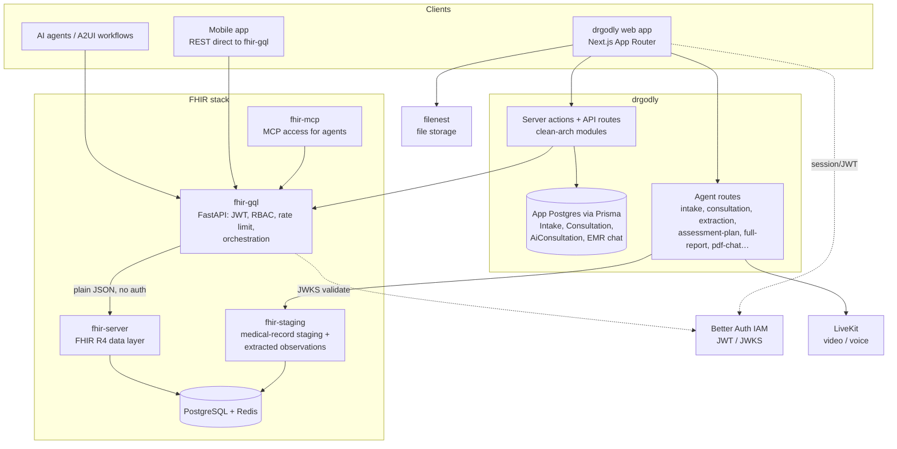
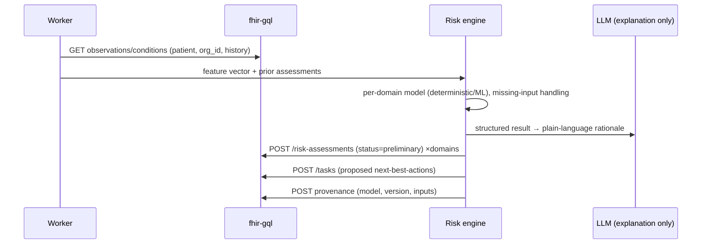
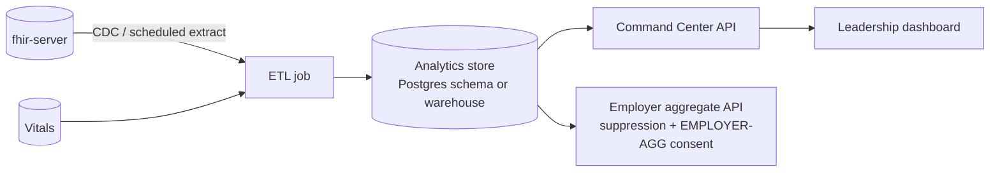

# SIMS AI Preventive Health Intelligence Platform — Technical Blueprint

| | |
|---|---|
| **Status** | Draft v1 — 23 Oct 2026 |
| **Audience** | Engineers (drgodly web/mobile, fhir-gql, fhir-server, fhir-staging), architects, security |
| **Companion** | [`functional-blueprint.md`](./functional-blueprint.md) — *what* each phase does and which resources it touches |
| **Basis** | Source as of: `drgodly` branch `chore/session-batch-2026-10-09`; `fhir-gql` `b653e21`; `fhir-server`, `fhir-staging`, `fhir-mcp` working trees under `E:\work\code\fhir` |

This document explains *how* the platform is built on the existing stack: the components, who owns which data, the API
surface per workflow stage, how each stage reads and writes FHIR resources, the design of the new capabilities (risk engine,
trajectory, staging promotion, consent, analytics), and the concrete gaps to close.

> **Facts vs. proposals.** Sections 2–5 and Appendix A describe the system **as it exists** (verified in source). Sections 6–12
> are **proposed design**. Every proposal is labelled *(proposed)* where it could be mistaken for existing behaviour.

---

## 1. Context and constraints

- FHIR R4 (4.0.1). The gateway can return FHIR JSON when the caller sends `Accept: application/fhir+json`; otherwise it returns the flattened JSON shape.
- FHIR is the system of record for clinical/administrative facts. Proprietary working data lives in the app database or staging service and is linked by id.
- Multi-tenant: every record belongs to one organisation; every search requires `org_id`.
- All date/time logic is pinned to IST (UTC+05:30); display format `dd-MM-yyyy` (project convention).
- The Next.js in this repo has breaking changes vs. common knowledge; read `node_modules/next/dist/docs/` before changing app code (project rule in `AGENTS.md`).
- Every new file follows the project documentation standard (file-level comment, JSDoc on public functions, inline comments for non-obvious logic) and naming rules (PascalCase components; camelCase/kebab-case non-components; Next.js reserved filenames unchanged).

---

## 2. System architecture (as built)



### 2.1 Component responsibilities

| Component | Responsibility | Notes |
|---|---|---|
| **drgodly** (Next.js) | UI, server actions, AI agent routes, A2UI workflow engine, clean-architecture server modules (`domain → infrastructure → usecases → controllers → DI → actions`) | `src/modules/server/core/*` has one module per resource; REST and GraphQL transports switchable via DI |
| **fhir-gql** (FastAPI) | Auth (JWKS-validated bearer JWT), RBAC (`resource:action` from JWT `permissions`), Redis sliding-window rate limit, request validation (Pydantic, rejects bad bodies with 422 before any network call), use-case orchestration (e.g. slot-aware booking) | Never touches a database; proxies to fhir-server via typed `httpx` clients. Despite its name it is a **REST** API; a `strawberry` GraphQL layer exists but only covers Patient and Organization |
| **fhir-server** (FastAPI + SQLAlchemy + Alembic) | Pure FHIR R4 data layer; one model/repository/service/router per resource; public integer ids from sequences; references stored as `type/id/display` columns (no foreign keys); mandatory `org_id` on search | Trusts payloads from the gateway; performs no business-rule validation |
| **fhir-staging** | Holding pen for uploaded medical-record documents and the Observations an AI agent extracts; separate clinician review state | Plain snake_case JSON; no auth; no FHIR wire format; nothing is promoted to fhir-server automatically |
| **fhir-mcp** | Model Context Protocol surface for agents (auth + config) | Reuses gateway auth |
| **App Postgres (Prisma)** | Proprietary session data: `Intake`, `Consultation` (+ draft columns), `AiConsultation`, EMR chat sessions/workflow state | Linked to FHIR by `fhir_appointment_id` / `patient_fhir_id` |
| **Better Auth (IAM)** | Issues JWTs (`sub`, `activeOrganizationId`, `permissions`) | Mobile exchanges its session for a JWT at `/api/auth/token` |
| **filenest** | Binary storage; staging stores only its opaque file handle | |
| **LiveKit** | Video/voice for consultations and voice intake | |

### 2.2 Request flow (as built)

```
Client → (Server action | API route | direct REST) → fhir-gql Router → Service → FhirClient (httpx) → fhir-server → Postgres
```

1. `get_current_user` validates the JWT globally on `/api/v1` (signature, `exp`, `iss`, `aud`) and stores the payload on `request.state.user`.
2. `require_permission(resource, action)` checks `"{resource}:{action}"` in the JWT `permissions` claim; `403` otherwise.
3. The router builds an `AuthUser(sub, org_id=activeOrganizationId)`; the **service injects `org_id`, `created_by`, `updated_by`** into the write — callers never supply them.
4. Search endpoints require `org_id`; get/update/delete-by-id do not accept it (the id fixes the tenant).

### 2.3 Data ownership

| Data | Owner | Linked by |
|---|---|---|
| Patient, Appointment, Encounter, Observation, Condition, orders, results, plans, risk | **fhir-server** (via fhir-gql) | `Type/id` references |
| Vitals (wearables, custom) | **fhir-server** custom `vitals` table (`/vitals`) | `patient_id`, `user_id`, `org_id` |
| AI intake transcript + report | App Postgres `Intake` | `fhir_appointment_id`, `patient_fhir_id` |
| Consultation transcript, SOAP, extracted resources (staged), drafts | App Postgres `Consultation` | `fhir_appointment_id` (1:1) |
| Uploaded records + extracted observations (pre-review) | **fhir-staging** | `patient_id`, `encounter_id`, `service_request_id` (fhir-server public ids) |
| Chat sessions / A2UI workflow state | App Postgres `EmrChat*` | `user_id` |
| Files | filenest | `file_id` in staging / DocumentReference |

---

## 3. The gateway API surface (as built)

All routes are under `/api/v1`, JWT-protected, rate-limited, and RBAC-guarded. Collection routes are `GET /` (search/list),
`POST /`, and item routes `GET|PATCH|DELETE /{id}`. FHIR output requires `Accept: application/fhir+json`.

| Prefix | Resource | Special routes | RBAC resource |
|---|---|---|---|
| `/organizations` | Organization | `GET /me` (caller's active organisation) | `org` |
| `/locations` | Location | | `location` |
| `/healthcare-services` | HealthcareService | | `healthcare_service` |
| `/schedules` | Schedule | | `schedule` |
| `/slots` | Slot | `POST /generate` (bulk generate, clamped to planning horizon) | `slot` |
| `/practitioners` | Practitioner | `POST /full`, `GET /{id}/full`, `GET /me`; child collections `names, identifiers, telecom, addresses, photos, qualifications, communications` | `practitioner` |
| `/practitioner-roles` | PractitionerRole | booking search (`GET` used by workflows as `/practitioner-roles/booking`) | `practitioner_role` |
| `/patients` | Patient | `POST /full`, `PATCH /{id}/full`, `GET /me`; child collections `names, identifiers, telecom, addresses, photos, contacts, communications, general-practitioners, links` | `patient` |
| `/appointments` | Appointment | `POST /book`, `GET /me`, `POST /{id}/reschedule` | `appointment` |
| `/encounters` | Encounter | | `encounter` |
| `/episode-of-cares` | EpisodeOfCare | | `episode_of_care` |
| `/service-requests` | ServiceRequest | | `service_request` |
| `/medication-requests` | MedicationRequest | | `medication_request` |
| `/observations` | Observation | | `observation` |
| `/conditions` | Condition | | `condition` |
| `/diagnostic-reports` | DiagnosticReport | | `diagnostic_report` |
| `/document-references` | DocumentReference | | `document_reference` |
| `/procedures` | Procedure | | `procedure` |
| `/questionnaires` | Questionnaire | | `questionnaire` |
| `/questionnaire-responses` | QuestionnaireResponse | | `questionnaire_response` |
| `/risk-assessments` | RiskAssessment | | `risk_assessment` |
| `/flags` | Flag | | `flag` |
| `/tasks` | Task | | `task` |
| `/care-plans` | CarePlan | | `care_plan` |
| `/care-teams` | CareTeam | | `care_team` |
| `/plan-definitions` | PlanDefinition | | `plan_definition` |
| `/activity-definitions` | ActivityDefinition | | `activity_definition` |
| `/vitals` | Vitals (custom, plain JSON only) | | `vitals` |
| `/terminology` | Concept lookup (`/terminology/concepts?resource=…&field=…`) | custom, not FHIR `ValueSet` | `terminology` |

**RiskAssessment search** (representative of the R4-style search added to the newer resources): `_id`, `identifier`, `status`,
`method`, `subject`, `patient`, `encounter`, `condition`, `performer`, `date` (prefixes `ge/le/…`, repeatable), `probability`
(prefixed number), `risk` (token of `prediction.qualitativeRisk`), `_lastUpdated`, `user_id`, **`org_id` (mandatory)**, `limit`
(1–200), `offset`. Token params accept `code`, `system|code`, `|code`, `system|`; comma = OR; reference params accept
`Type/id` or bare id. These are exactly what trajectory and cohort queries need.

**Booking orchestration** (`POST /appointments/book`): validates the Slot is `free`; builds the participant array from
practitioner + patient (+ display names); creates the Appointment (inheriting appointment type from the Slot); sets the Slot
`busy`; **rolls back the Appointment if the Slot update fails**; returns `409` if the slot is no longer free.

**Immutability rule:** on several resources child arrays (`category`, `note`, `reference_range`, `dosage_instruction`, …) can only be set at create. PATCH carries scalar fields only; some newer resources use *replace-semantics* PATCH for child lists. The client must delete + re-create to change an immutable array.

**RiskAssessment input rules (R4 invariants enforced at the gateway):** `prediction.probability` must be ≤ 100 (ras-2); probability range units must be `%` (ras-1); `status` uses the Observation status value set (`registered | preliminary | final | amended | corrected | cancelled | entered-in-error | unknown`). `reasonCode`, `reasonReference` (Condition/Observation/DiagnosticReport/DocumentReference), `basis` (any resource), `note`, `identifier`, and multiple `prediction` entries are all supported.

---

## 4. drgodly application layer (as built)

| Concern | Where | Behaviour |
|---|---|---|
| Server modules | `src/modules/server/core/{appointment,condition,diagnostic-report,document-reference,encounter,healthcare-service,location,medication-request,observation,organization,patient,practitioner,practitioner-role,schedule,service-request,slot,terminology,vitals}` | One clean-arch module per FHIR resource; DI container switches REST ↔ GraphQL transports |
| App-data modules | `…/core/{intake,consultation,ai-consultation,emr-chat}` | Prisma repositories |
| Staging client | `…/core/staging-medical-record` (REST + GraphQL services; create/list/get/update/delete/review) | Talks to `fhir-staging` |
| API routes | `src/app/api/{intake,consultation,ai-consultation,mobile,workflow,…-agent}` | Agent endpoints, mobile OpenAPI (`/api/mobile`) |
| A2UI workflows | `src/modules/client/ai-hub/workflows/**.json` registered in `src/app/api/workflow/_registry.ts` | Declarative multi-step forms/chat that call gateway endpoints via `$fhir_gql_url` |
| Doctor review | `…/telemedicine/doctor/component/appointment-review/` | Staging → accept → EMR publish (see §6.4) |
| Doctor dashboard | `…/telemedicine/doctor/component/dashboard/` | Consultation + vitals insights (4 wearable fields pending mobile confirmation) |

**A2UI workflow catalogue (as registered):** appointment (`book_appointment`), audit (`record_provenance`), billing
(`create_billing_cycle`), care (`create_care_plan_with_task`), clinical (`add_consultation_extractions`, `record_allergy_intolerance`,
`record_condition`, `record_observation`, `record_procedure`, `record_questionnaire_response`, `record_specimen`, `record_vitals`,
`patient_chart_review`), coverage (`create_coverage`), encounter (`open_encounter`, `close_encounter`), healthcare service, location,
medication (`create_medication`), orders (`create_device_request`, `create_medication_request`, `create_service_request`,
`record_immunization`), organization, patient (`create_patient`, `admin_create_patient`), practitioner (+role, photo), related person,
results (`create_diagnostic_report`, `create_document_reference`, `upload_patient_report`, `doctor_upload_patient_report`),
schedule (`create_schedule_with_slots`, `generate_slots`), vitals (`view_vitals_dashboard`, `view_vitals_table`).

> ⚠ **Observed inconsistency to resolve (G2).** Several of these workflows call gateway paths such as
> `/allergy-intolerances/`, specimens, coverages, related persons, immunizations, medications and device requests, but
> `fhir-gql/app/routers/` contains **no router** for those resources, even though `fhir-server` has them. Either those workflows
> are currently non-functional against the gateway, or they point at a different base URL. Verify per workflow before relying on them.

---

## 5. End-to-end workflow → API mapping (as built vs. target)

For each phase: the calls that exist today, the calls to add *(proposed)*, and the resource effect. Resource notation: **C**reate / **R**ead / **U**pdate / **D**elete.

### Phase 0 — Foundation
| Step | Call | Resource effect |
|---|---|---|
| Org/location/people | `POST /organizations`, `/locations`, `/practitioners/full`, `/practitioner-roles` | C Organization, Location, Practitioner(+children), PractitionerRole |
| Service | `POST /healthcare-services` | C HealthcareService (`program`, `eligibility`, `availableTime`) |
| Availability | `POST /schedules`, `POST /slots/generate` | C Schedule; C Slot[] (bulk) |
| Protocol | `POST /plan-definitions`, `/activity-definitions`, `/questionnaires` | C PlanDefinition, ActivityDefinition, Questionnaire |
| *(proposed)* risk-domain config | `PlanDefinition` of type `eca-rule`, or a versioned config table in the risk-engine service | C PlanDefinition / config |

### Phase 1 — Enrollment, consent, history
| Step | Call | Resource effect |
|---|---|---|
| Find/create patient | `GET /patients?…`, `POST /patients/full` | R/C Patient (+children) |
| Programme episode | `POST /episode-of-cares` | C EpisodeOfCare |
| Cover | *(proposed)* `/coverages` router | C Coverage |
| Consent | *(proposed)* `/consents` (model, router) | C Consent |
| History upload | `POST filenest` → `POST fhir-staging /staging-records` | C StagingRecord (`pending`) |
| Extraction | agent `PATCH /staging-records/{id}` | U StagingRecord (`observations[]`, `status`) |
| Review | `PATCH /staging-records/{id}/review` | U review_status (`accepted/rejected/needs_revision`) |
| Promote *(proposed)* | `POST /staging-records/{id}/promote` via orchestration | C Observation[] + DocumentReference (+ DiagnosticReport); U StagingRecord (`promoted_at`) |

### Phase 2 — Outreach (all *proposed*)
Cohort job queries Patient/Coverage/EpisodeOfCare; creates one `Task` per outreach attempt (✅ gateway) and, once `Communication` exists, a `CommunicationRequest` + `Communication`. See §9.

### Phase 3 — Pre-screen & scheduling
| Step | Call | Resource effect |
|---|---|---|
| Profile check | `GET /patients/me` | R Patient (token-derived) |
| Provider search | `GET /practitioner-roles/booking`, `GET /healthcare-services` | R |
| Free slots | `GET /slots?status=free&…` | R Slot |
| AI intake | `POST /api/intake/create`, `PATCH /api/intake/update` (app DB) | `Intake` row (not FHIR) |
| Book | `POST /appointments/book` | C Appointment; U Slot (`busy`) |
| Link intake | `POST /api/intake/link` (sets `fhir_appointment_id`) | `Intake` ← appointment |
| Reschedule / cancel | `POST /appointments/{id}/reschedule`, `PATCH`/`DELETE` | U Appointment; U Slot |
| *(proposed)* structured answers | `POST /questionnaire-responses` (mirror of intake answers) | C QuestionnaireResponse |

### Phase 4 — Check-in & encounter
| Call | Effect |
|---|---|
| `PATCH /appointments/{id}` `status=arrived` | U Appointment |
| `POST /encounters` (links appointment, episode, participants, location) | C Encounter (`in-progress`) |
| `POST /flags` | C Flag |
| `PATCH /episode-of-cares/{id}` | U EpisodeOfCare (when visit is linked) |

### Phase 5 — Intake & history
`POST /questionnaire-responses` (C QuestionnaireResponse) → application extraction → `POST /observations`, `/conditions`
(C Observation with `derived_from` the response; C Condition) → allergies via *(proposed)* `/allergy-intolerances`.

### Phase 6 — Orders & care plan
| Step | Call | Effect |
|---|---|---|
| Resolve protocol | `GET /plan-definitions/{id}`, `GET /activity-definitions/{id}` | R |
| Evaluate (app code) | evaluator in drgodly/orchestrator *(proposed §6.6)* | — |
| Orders | `POST /service-requests` per action (shared requisition id) | C ServiceRequest[] |
| Fulfilment tasks | `POST /tasks` (`based_on` ServiceRequest, `owner` lab/radiology) | C Task[] |
| Plan & team | `POST /care-plans`, `POST /care-teams` | C CarePlan, CareTeam |

### Phase 7 — Vitals
`POST /observations` (category `vital-signs`; BP as a panel with components; BMI `derived_from` weight+height; `interpretation` H/N/L). Optional `POST /procedures` for ECG. Wearable/manual stream: `POST /vitals`.

### Phase 8 — Specimen, lab, imaging
| Call | Effect |
|---|---|
| *(proposed)* `POST /specimens` | C Specimen |
| `PATCH /tasks/{id}` (`accepted → in-progress → completed`) | U Task |
| `POST /observations` (one per analyte, `based_on` ServiceRequest, `specimen`, ranges, interpretation) | C Observation[] |
| `POST /diagnostic-reports` (groups results; `result` references) | C DiagnosticReport |
| `POST /document-references` (report PDF/ECG) | C DocumentReference |
| Amend a final result | `PATCH` status `amended` / `corrected` (do not overwrite) | U Observation |

### Phase 9 — AI health profile & risk *(proposed)*
Triggered when all result Observations for the encounter are `final`. Detailed in §6.1–6.3. Writes `RiskAssessment` (`preliminary`) per domain, optionally `Observation` (composite scores), `Task` (proposed actions), and `Provenance`.

### Phase 10 — Clinician review
| Call | Effect |
|---|---|
| `GET /risk-assessments?patient=…&encounter=…&status=preliminary` | R |
| `PATCH /risk-assessments/{id}` `status=final` (+ clinician note) | U RiskAssessment |
| `POST/PATCH/DELETE /conditions`, `/service-requests`, `/medication-requests`, `/observations` | diffed publish (§6.4) |
| `POST /flags` | C Flag |

### Phase 11 — Personal plan
`POST /care-plans` (activities, `period`) → `POST /tasks` per activity (`based_on` CarePlan, `for` patient, `owner`, `restriction.period`) → `POST /medication-requests`, `/procedures` (counselling). *(Goal absent: see §11, G5.)*

### Phase 12 — Referral
`POST /service-requests` (`category=referral`) → `POST /tasks` → `POST /appointments/book` for the specialist.

### Phase 13 — Report
`PATCH /encounters/{id}` `status=finished`; `PATCH /appointments/{id}` `status=fulfilled`; report PDF to filenest → `POST /document-references`.

### Phase 14 — Monitoring, coaching, recall
`POST /vitals` (mobile/wearable); thresholds → `POST /tasks` / `POST /flags`; promoted readings → `POST /observations`; re-assessment re-enters phase 9; rebooking via `/appointments/book`.

### Phase 15 — Billing *(mostly proposed)*
Gateway routers for Coverage, Claim, ClaimResponse, Invoice (fhir-server models exist); charge capture resources to be added.

### Phase 16–17 — Population, quality, audit *(proposed)*
Analytics read model (§10); `Provenance` and `AuditEvent` routers; `Consent` enforcement (§8).

---

## 6. Design of the new capabilities *(proposed)*

### 6.1 Risk engine

**Placement.** A new service (`risk-engine`, Python or the existing agent runtime) *behind the gateway's auth boundary*: it consumes
FHIR via fhir-gql with a service JWT scoped to `observation:read`, `condition:read`, `risk_assessment:create|update`, `task:create`,
and writes only `preliminary` results. It never calls fhir-server directly.

**Trigger.** Poll-based until Subscription exists: a worker scans for encounters whose ServiceRequests are all fulfilled and whose
result Observations are `final`, plus a manual "recompute" action. (Event-driven once §11 G10 lands.)

**Pipeline**



**Separation of duties.** Numeric/qualitative risk comes from a **deterministic or validated ML model**. The LLM only phrases
the explanation and top-3 priorities; it must not change the score. Models are versioned; the version string is stored in
`RiskAssessment.method` and `Provenance`.

**RiskAssessment mapping (one resource per domain per run)**

| FHIR element | Value |
|---|---|
| `status` | `preliminary` → `final` after clinician acceptance (never edited in place afterwards; a new run creates a new resource) |
| `method` | CodeableConcept: model id + version (e.g. system `https://sims.example/fhir/risk-model`, code `metabolic-v1.2`) |
| `code` | Risk domain: `metabolic`, `cardiovascular`, `diabetes`, `renal`, `liver`, `nutrition`, `fitness`, `sleep` (local CodeSystem; map to SNOMED where one exists) |
| `subject` / `encounter_id` | `Patient/{id}` / integer public encounter id (the gateway input takes `encounter_id`, not a reference string) |
| `occurrenceDateTime` | Computation time (IST) |
| `performer` | `Device` or `Practitioner/PractitionerRole` for the model identity (until `Device` exists: `performer` omitted + `method` + `Provenance`) |
| `basis[]` | `Observation/{id}` list used (this is the explainability link) |
| `reasonReference[]` | Existing `Condition`s that influenced the score (the single `condition` field is for the condition the assessment is *about*) |
| `prediction[0].outcome` | e.g. "Type 2 diabetes within 5 years" |
| `prediction[0].qualitativeRisk` | `low | moderate | high` (RiskProbability value set) |
| `prediction[0].probabilityDecimal` | percent (0–100) when the model is calibrated |
| `prediction[0].whenPeriod` | prediction horizon |
| `mitigation` | Short text of recommended pathway |
| `note[]` | AI rationale (author_string = model id) and, later, the clinician's note |
| `identifier` | Two entries: `{run_id}` (groups the domains of one run) and a **domain tag** (system `https://sims.example/fhir/risk-domain`, value e.g. `diabetes`). The gateway's `identifier` token search supports `system|value`, so this is how trajectory queries filter by domain — `code` is writable but is **not** a search parameter today (adding a `code` token search to fhir-server is a small change worth making) |

**Trend.** Derived at read time (§6.3), not stored on the resource.

### 6.2 Package-aware interpretation

Package → PlanDefinition mapping is data, not code. The engine reads the patient's package (`Appointment.service_type` /
`HealthcareService`) and the protocol's `ActivityDefinition`s to know which inputs *should* exist, then:
- computes domains whose required inputs are present;
- for domains with gaps, emits a `Task` ("recommend test X") instead of a score;
- selects a **pathway** `PlanDefinition` by matching the domain/risk to PlanDefinitions tagged with that domain (`useContext`/`topic`), and links it as `RiskAssessment.mitigation` text plus a proposed CarePlan (`instantiates_canonical`).

### 6.3 Trajectory API

Two options; start with (a) for the pilot.

**(a) Compose in the BFF (Next.js server action).** For each domain, `GET /risk-assessments?patient=…&identifier=https://sims.example/fhir/risk-domain|diabetes&status=final&date=ge2024-01-01&limit=…&org_id=…`,
group by year in IST, compute trend from the last two, and fetch `basis` Observations for contributors. No new backend.

**(b) Read model (scale/performance).** The analytics store (§10) materialises `patient × domain × year → level, trend, contributors`
for dashboards. Source of truth stays the RiskAssessments.

Response shape (BFF):

```jsonc
{
  "patient_id": 10001,
  "domains": [
    {
      "domain": "diabetes",
      "points": [{"year":2024,"level":"low"},{"year":2025,"level":"moderate"},{"year":2026,"level":"high"}],
      "trend": "worsening",
      "contributors": [{"observation":"Observation/160001","label":"HbA1c","direction":"up"}]
    }
  ],
  "top_priorities": [{"text":"Improve activity","task":"Task/280010"}]
}
```

(`level` uses the same qualitative risk codes as the resource; `trend` is computed, never stored.)

### 6.4 Staging → accept → EMR (existing pattern, reused)

The doctor review screen already implements a three-state model; the preventive flow reuses it for AI profile items:

1. **Suggestion** (unreviewed): held in app DB draft columns (`Consultation.draft_*`, autosaved) or in `fhir-staging`, or as `preliminary` RiskAssessments.
2. **Draft** (doctor editing): autosave never overwrites confirmed data; the final write *converges content* rather than racing timing.
3. **Published**: `publishClinicalRecords` diffs the form against the fhirIds loaded at mount — present id → PATCH, absent id → POST, missing now → DELETE — running all resource types in parallel (`Promise.all`). It returns a `{localId → fhirId}` map so the UI recognises newly created items without a refetch. `published_at/by` are stamped **server-side** only.

Because child arrays are immutable after create, an *edit* of a child array must delete and re-create.

### 6.5 History import: promotion step

`fhir-staging` deliberately does not write to FHIR. Add an orchestration use-case (in drgodly server module, or fhir-gql) that:
1. requires `review_status = accepted`;
2. maps each staged observation (flattened R4 columns, ported column-for-column from fhir-server) to the gateway's Observation create payload — near 1:1 by design;
3. creates `DocumentReference` for the source file (filenest handle → `Attachment`), optional `DiagnosticReport` grouping;
4. writes `staging_record.promoted_at` and the created fhir ids (idempotency key = staging id; re-running must not duplicate);
5. emits `Provenance` (source: staging id, extractor model, reviewer).

### 6.6 Protocol evaluation (no `$apply`)

Implement `applyPlanDefinition(planDefinitionId, patientId, encounterId)` as a use-case:
1. `GET /plan-definitions/{id}`; for each `action`, `GET` the referenced `ActivityDefinition`.
2. Evaluate `condition` expressions with a small, **non-CQL** rule evaluator (age, gender, active conditions, prior results) kept as JSON rules in the action's `condition.expression` (language `text/fhirpath` or a custom code) — full CQL is out of scope for the pilot.
3. Create ServiceRequest + Task per applicable action (same `requisition`), then CarePlan + CareTeam.
4. Run as a single idempotent unit keyed by `(encounter, planDefinition, version)`; on partial failure, compensate (delete created resources) or resume — the gateway has no transaction bundle (§11 G7).

### 6.7 Coach and copilot

- **Copilot** is read-only: composes patient summary from `RiskAssessment`, `Observation`, `Condition`, `CarePlan`, prior encounters; reuses the existing patient-chart-review building blocks.
- **Coach** is a grounded chat: retrieval restricted to the authenticated patient's FHIR + Vitals; system prompt forbids diagnosis; symptom keywords escalate to a human `Task`. It can create `Task`s ("please call me") but no clinical resources.
- Both run behind the existing agent route pattern and are logged in the EMR chat tables.

### 6.8 Vitals ↔ Observation bridge

`/vitals` is a custom, wide, metric-per-column table (steps, calories, distance, active minutes, HR, resting HR, HRV, stress score, BP, sleep, weight/height, …). To make trajectories and interoperability work:
- Keep `/vitals` for high-volume raw ingestion and the existing dashboards.
- A scheduled job (daily) **promotes** clinically relevant aggregates (7-day average resting HR, home BP readings, weight) to FHIR `Observation` with `category=vital-signs` (or `activity`), `device` omitted, and `derivedFrom` unavailable (Vitals is not FHIR) → store source row id in an `identifier`.
- Do **not** mirror every sample: Observation volume would dominate the clinical store.

---

## 7. Identity, tenancy and security (as built + additions)

| Control | Status | Detail |
|---|---|---|
| Authentication | ✅ | Better Auth JWT validated against JWKS (`iss`, `aud`, `exp`) at gateway |
| RBAC | ✅ | `resource:action` from JWT `permissions`; resource names listed in §3; **new resources need new permission names** (`consent`, `provenance`, `communication`, `group`, …) |
| Tenant isolation | ✅ | `org_id` = JWT `activeOrganizationId`, stamped server-side; mandatory on searches; **mobile must send it itself** on creates (body) and searches (query) |
| Rate limiting | ✅ | Redis sliding window per user/IP, read vs write limits; in-process fallback is not multi-worker safe |
| Service-to-service | ◐ | fhir-gql → fhir-server is plain, unauthenticated HTTP on a private network; fhir-staging has no auth — **must stay unreachable from clients** |
| PHI in AI | 🔴 | Define what leaves the boundary to LLM providers; redact identifiers; log prompts/outputs with ids only |
| Consent enforcement | 🔴 | See §8 |
| Audit | ◐ | `AuditEvent`/`Provenance` models exist in fhir-server but are not exposed; add routers and write on read/export of PHI |
| Employer aggregates | 🔴 | Separate read model + minimum cohort size; never query clinical resources from employer-scoped tokens |

---

## 8. Consent *(proposed — gap G1)*

**Resource.** Add `Consent` (fhir-server model/migration/repo/service/router + gateway router, following the project's
`new-fhir-resource` skill). Key fields: `status`, `scope` (treatment/patient-privacy/research), `category`, `patient`,
`dateTime`, `performer`, `organization`, `policyRule`, `provision` (`permit`/`deny` with nested provisions and `purpose`).

**Purposes** (local value set, mapped to `v3-ActReason` where possible): `TREAT`, `HPAYMT`, `AI-ANALYSIS`, `WEARABLE`, `RESEARCH`, `EMPLOYER-AGG`.

**Enforcement points**

| Point | Check |
|---|---|
| Risk-engine worker | Skip patients without an active `AI-ANALYSIS` permit |
| Vitals ingestion | Reject/ignore writes without `WEARABLE` |
| Aggregate builder | Exclude patients without `EMPLOYER-AGG` from employer cohorts (and without `RESEARCH` from any research export) |
| Coach | Disable without `AI-ANALYSIS` |
| Withdrawal | `PATCH` status `inactive` → stops the above from that timestamp; previously created records remain (clinical record) but are excluded from new aggregates |

A small `consentService.isPermitted(patientId, purpose, at)` with a short TTL cache fronts all checks.

---

## 9. Outreach, nudges and eventing *(proposed — G6, G10)*

Until `Communication`, `CommunicationRequest`, `Group`, `Subscription` are built:

| Need | Interim design |
|---|---|
| Cohort | Saved server-side query (age, gender, coverage group, last screening date) evaluated by a job; membership snapshot stored in the job table, not FHIR |
| Invitation/reminder record | One `Task` per attempt (`code` = outreach, `focus` = Patient, `for` = patient, `restriction.period`), status `requested → completed/failed` |
| Delivery | Notification provider (SMS/WhatsApp/push) behind an interface; delivery receipts written to the Task `output` |
| Events | Scheduled worker (cron/queue) polling Tasks due, Appointments in 24 h/2 h, results `final`, Vitals thresholds |

Target: add `CommunicationRequest` + `Communication` (+ `Group`) following the same resource-addition recipe, then migrate jobs to them.

---

## 10. Analytics and population intelligence *(proposed — G8)*

**Why a read model.** Population queries (counts by domain, high-risk-no-follow-up, adherence, cohort cuts) are cross-patient
aggregations the FHIR search API is not designed for, and employer views must never touch clinical rows.



**Tables (sketch)**

| Table | Grain | Key columns |
|---|---|---|
| `fact_risk` | patient × domain × assessment | org_id, patient_id, domain, level, probability, trend, assessed_at, model_version |
| `fact_followup` | patient × plan activity | due, completed, overdue_days, task_status |
| `fact_vitals_daily` | patient × day | steps, resting_hr, sleep_min, … |
| `dim_patient` | patient | age_band, gender, employer_org_id, packages |
| `dim_cohort` | cohort | definition, size |

**Dashboards ↔ metrics:** enrolled; high-risk by domain; **high-risk without follow-up** = latest `final` high RiskAssessment with no
completed follow-up Task/Appointment within SLA; adherence = completed / due activities; improving/deteriorating = trend sign over
the last two assessments.

**Employer API** reads only pre-aggregated tables, applies a minimum cell size, and filters by `EMPLOYER-AGG` consent and the employer's `org_id`.

All access is `org_id`-scoped; SIMS-wide views require an explicit admin permission.

---

## 11. Gap register with implementation design

Priority is for the 90-day pilot. "Recipe" = follow the project's resource-addition process: fhir-server model → migration → schemas →
mapper → repository (R4 search params, mandatory `org_id`) → service → router → tests; then fhir-gql client → service → DI module/dependency →
router → input/response schemas; then drgodly server module/actions and (optionally) an A2UI workflow.

| ID | Gap | Design | Effort | Prio |
|---|---|---|---|---|
| **G1** | Consent resource | §8; recipe + `consentService` enforcement points | M | P0 |
| **G2** | 13 server-only resources lack gateway routers (AllergyIntolerance, Specimen, Coverage, RelatedPerson, Immunization, Medication, DeviceRequest, Claim, ClaimResponse, Invoice, InsurancePlan, Provenance, AuditEvent) | Gateway layer only (client, service, DI, router, schemas) — fhir-server side exists. First verify which A2UI workflows currently fail | M per batch | P0 |
| **G3** | Risk engine + trajectory | §6.1–6.3 | L | P0 |
| **G4** | Staging promotion | §6.5; add `promoted_at`, `promoted_ids` to staging record | M | P0 |
| **G5** | Goal, ClinicalImpression, FamilyMemberHistory, MedicationStatement | Recipe ×4; interim workarounds listed in functional blueprint | M | P1 |
| **G6** | Communication, CommunicationRequest, Group | Recipe ×3; §9 | M | P1 |
| **G7** | No `$apply` / `$extract` / transaction Bundle | §6.6 app-level evaluator; later a gateway `POST /transactions` that executes an ordered list with compensation | M–L | P1 |
| **G8** | Analytics read model | §10 | L | P1 |
| **G9** | Vitals is custom | §6.8 promotion job | S–M | P1 |
| **G10** | Eventing | Poll now; Subscription (rest-hook/websocket) later | M | P2 |
| **G11** | Billing resources | Account, ChargeItem(+Definition), CoverageEligibility*, ExplanationOfBenefit, PaymentNotice; expose existing Claim/Invoice | L | P2 |
| **G12** | Device, DeviceDefinition, ObservationDefinition, SpecimenDefinition, ImagingStudy | Recipe; ObservationDefinition replaces ad-hoc range logic | M | P2 |
| **G13** | Intake/AI-consultation only in app DB | Mirror structured answers to `QuestionnaireResponse` on intake completion | S | P1 |
| **G14** | gateway README/ARCHITECTURE stale (README says 17 resources; DI tree lists 17) | Update docs to the current 29 routers + vitals/terminology | S | P2 |

---

## 12. Cross-cutting engineering rules

**Terminology.** Use LOINC for observations, SNOMED CT for findings/procedures, ICD-10 for reasons, UCUM for units. Resolve displays via the
`/terminology` module; validate any code before write. Local code systems (risk domains, pathways, outreach) are namespaced under one SIMS base URL and
documented in a single registry file.

**Identifiers and references.** References are `Type/id` strings; fhir-server stores them without foreign keys, so **referential integrity is the
application's job** — validate that referenced resources exist and belong to the same `org_id` before writing. Public ids come from sequences (per-resource
starting ranges), not database primary keys.

**Time.** Store ISO-8601 with `+05:30`; compute "year" buckets for trajectories in IST; display `dd-MM-yyyy`.

**Idempotency.** All orchestration use-cases (booking, apply-protocol, promotion, risk run) take a natural idempotency key and are safe to retry.

**Error mapping.** Follow the gateway's convention: validation → 422, permission → 403, not found → 404, slot taken → 409, rate limit → 429; surface `409` booking
conflicts to the UI as "slot no longer available".

**Testing.** fhir-server has per-resource tests (search params, invariants); gateway adds schema/validation tests; add contract tests for each orchestration use-case, golden tests for
the risk engine (fixed inputs → fixed domain results), and an authorisation matrix test (role × resource × action × tenant).

**Observability.** Request-id middleware exists; add structured logs for each orchestration step and risk run (run id, model version, domains, inputs count, duration).

**Deployment.** Each service has its own Dockerfile/compose; the gateway joins the shared network with fhir-server; fhir-staging and the future risk-engine/analytics must stay on the
private network. The Airflow VPS compromise on record means: rotate secrets and rebuild before hosting any PHI-touching new worker there.

---

## 13. Delivery plan (suggested)

| Sprint | Deliverables |
|---|---|
| 1 | G2 gateway routers (allergy, specimen, coverage, provenance first); G13 intake→QR mirror; verify broken workflows; update gateway docs (G14) |
| 2 | G1 Consent; consent-aware wrappers; G4 staging promotion + history import UI |
| 3 | G3 risk engine v0 (metabolic, CV, diabetes) with provenance; preliminary → final review UI |
| 4 | Trajectory screen (BFF §6.3a); copilot summary; top-3 priorities |
| 5 | G5 Goal/ClinicalImpression; personal plan + 30/60/90 tasks; applyPlanDefinition (§6.6) |
| 6 | Coach (grounded), nudges (§9), Vitals promotion (G9) |
| 7 | Analytics read model + command centre (G8); employer aggregates |
| 8 | Hardening: audit trail, authorisation matrix tests, load tests, pilot dry-run |

---

## Appendix A — What exists, verified

**fhir-server resources (models + routers):** activity_definition, allergy_intolerance, appointment, audit_event, care_plan, care_team, claim,
claim_response, condition, coverage, device_request, diagnostic_report, document_reference, encounter, episode_of_care, flag, healthcare_service, immunization,
insurance_plan, invoice, location, medication, medication_request, observation, organization, patient, plan_definition, practitioner, practitioner_role,
procedure, provenance, questionnaire, questionnaire_response, related_person, risk_assessment, schedule, service_request, slot, specimen, task, terminology, vitals.

**fhir-gql routers:** activity_definition, appointment, care_plan, care_team, condition, diagnostic_report, document_reference, encounter, episode_of_care, flag,
healthcare_service, location, medication_request, observation, organization, patient, plan_definition, practitioner, practitioner_role, procedure, questionnaire,
questionnaire_response, risk_assessment, schedule, service_request, slot, task, terminology, vitals.

**Server-only (no gateway router):** allergy_intolerance, audit_event, claim, claim_response, coverage, device_request, immunization, insurance_plan, invoice, medication,
provenance, related_person, specimen.

**Latest FHIR-side change (commit `b653e21`, 11 Oct 2026):** added Questionnaire, RiskAssessment, Flag, PlanDefinition, ActivityDefinition, CareTeam; reworked Procedure,
QuestionnaireResponse, Task, EpisodeOfCare, CarePlan (R4 search params, mandatory `org_id` on search, replace-semantics PATCH for child lists); references became plain
`type/id/display` columns; REST gateway layer added for 11 resources.

**Prisma models:** `Test`, `Intake`, `Consultation`, `AiConsultation`, `EmrChatSession`, `EmrChatMessage`, `EmrWorkflowState`, `EmrWorkflowStepSubmission`.

## Appendix B — Resource × phase matrix

R = read, C = create, U = update. Blank = not used. *(n/b)* = not built.

| Resource | 0 | 1 | 2 | 3 | 4 | 5 | 6 | 7 | 8 | 9 | 10 | 11 | 12 | 13 | 14 | 15 | 16 | 17 |
|---|---|---|---|---|---|---|---|---|---|---|---|---|---|---|---|---|---|---|
| Organization | C | R | R | | | | | | | | | | | | | R | R | |
| Location | C | | | R | R | | | | | | | | | | | | | |
| Practitioner / PractitionerRole | C | | | R | R | | R | R | R | | R | R | R | R | | | | |
| HealthcareService | C | | | R | | | | | | | | | | | | | | |
| Schedule / Slot | C | | | C/U | | | | | | | | | | | | | | |
| Patient | | C | R | R | R | R | R | R | R | R | R | R | R | R | R | R | R | |
| RelatedPerson | | C | | | | | | | | | | | | | | | | |
| Coverage | | C | R | | R | | | | | | | | | | | R | | |
| (Consent) *(n/b)* | | C | R | | | | | | | R | | | | | R | | R | C/U |
| EpisodeOfCare | | C | | | R | | | | | R | | | | | U | C | R | |
| Appointment | | | | C | U | | | | | | | | C | U | C | | R | |
| Encounter | | | | | C | R | R | R | R | R | R | R | | U | | R | R | |
| Flag | | | | | C | | | | | | C | | | | C | | | |
| QuestionnaireResponse | | | | C | | C | | | | R | | | | | | | | |
| Observation | | C (history) | | | | C | | C | C | R/C | C/U | | | | C | | R | |
| Condition | | | | | | C | | | | R | C/U | | | | | | R | |
| AllergyIntolerance | | | | | | C | | | | | | | | | | | | |
| PlanDefinition / ActivityDefinition / Questionnaire | C | | | | | R | R | | | R | | | | | | | | |
| ServiceRequest | | | | | | | C | | R | | C/U | | C | | | | | |
| Task | | | C | | | | C | | U | C | C | C | C | | C/U | | R | |
| CarePlan / CareTeam | | | | | | | C | | | | | C | | | U | | R | |
| MedicationRequest | | | | | | | | | | | C | C | | | | | | |
| Procedure | | | | | | | | C | | | | C | | | | | | |
| Specimen | | | | | | | | | C | | | | | | | | | |
| DiagnosticReport | | | | | | | | | C | | | | | R | | | | |
| DocumentReference | | C | | | | | | | C | | | | R | C | | | | |
| RiskAssessment | | | | | | | | | | C | U | | | | C | | R | |
| Vitals (custom) | | | | | | | | C | | R | | | | | C | | R | |
| Provenance | | C | | | | | | | | C | C | | | | | | | C |
| AuditEvent | | | | | | | | | | | | | | | | | | C |
| Claim / Invoice | | | | | | | | | | | | | | | | C | | |
| Staging record (fhir-staging) | | C/U | | | | | | | | | | | | | | | | |
